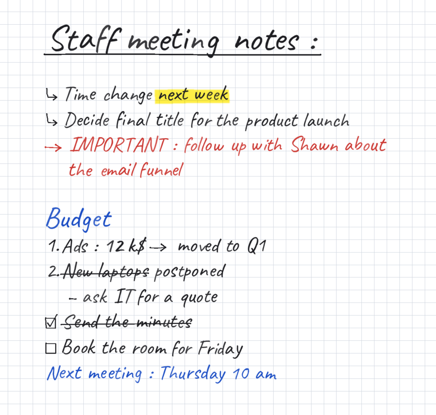
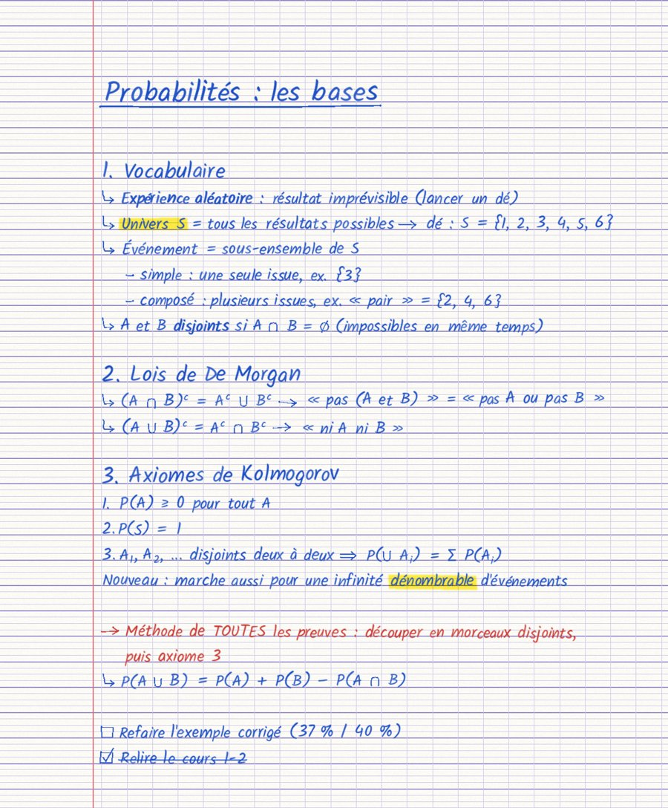
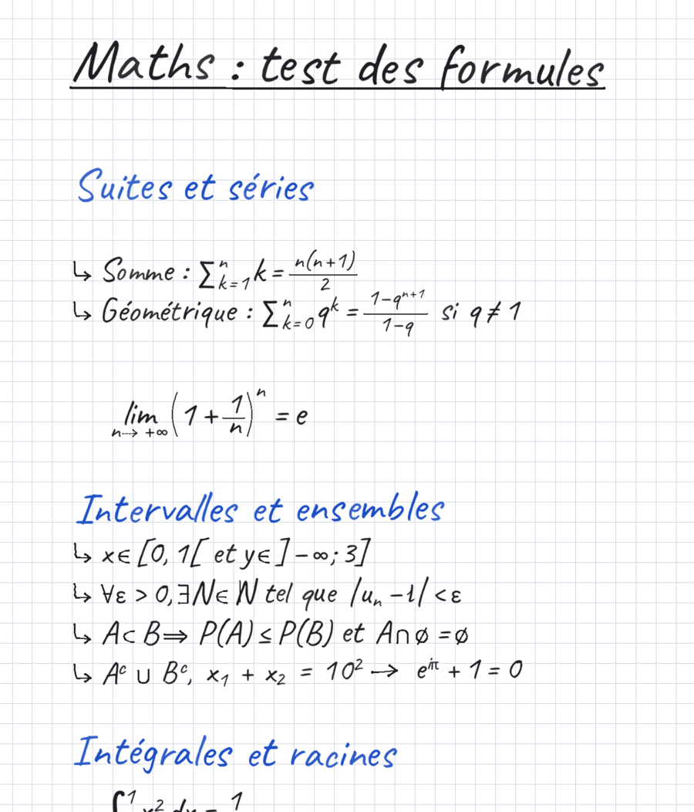
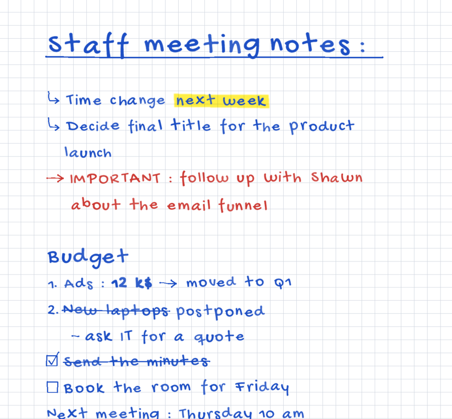

# handwritten-notes-skill

**Give an AI a PDF, some text or a photo. Get back notes that look written by hand,** on iPad grid paper or in a school notebook, in a handwriting font or **in your own handwriting**.

It works as an [Agent Skill](https://agentskills.io) (Claude, ChatGPT, Codex, any agent that can run Python) and as a plain command-line tool. Free and open source.

| iPad grid | French notebook (Seyès) | Maths | Your own handwriting |
|---|---|---|---|
|  |  |  |  |

## What it does

1. **Reads anything**: a PDF, pasted text, a web page, or a photo of a page or whiteboard. The AI reads photos itself.
2. **Writes real notes, not a copy**: a title and sections, short lines, highlighted key terms, red **IMPORTANT** lines, arrows, to-do boxes.
3. **Draws them by hand**. Every letter is slightly different in size, angle and height. Lines drift a little. Underlines wobble, and highlighter strokes have rough edges.
   - Papers: grid (iPad), dots, lines, blank, US college ruled, French Seyès.
   - Inks: black, blue, red, green, purple, pencil.
   - Maths: fractions, sums and integrals with their bounds, roots, powers and indices, intervals `[0, 1[`, ℝ ℕ, ∀ ∃ ∈ ⊂ ∩ ∪ ∅, and Greek letters, all drawn by hand.
4. **Learns your handwriting**: fill in a 2-page template with your pen (on paper or on an iPad), take photos, and every future note is written with your letters. Photos can be tilted or sideways.

## Install

### Claude (claude.ai, desktop)
Download the zip from [Releases](../../releases), then go to **Settings → Capabilities → Skills → Upload skill**.

### Claude Code
```bash
git clone https://github.com/yahyaraissouni/handwritten-notes-skill ~/.claude/skills/handwritten-notes
```

### ChatGPT
- **If your ChatGPT has Skills**: upload the same zip.
- **If it doesn't**: create a custom GPT. Paste the content of `SKILL.md` into *Instructions*, upload `scripts/handnotes.py` and the files in `fonts/` as *Knowledge*, and turn on *Code Interpreter*.

### Any other agent, or no AI at all
```bash
pip install pillow numpy
python scripts/handnotes.py render examples/maths.md -o notes.pdf --paper grid --font caveat
```

## Use

Ask in plain words:

> Turn this PDF into handwritten iPad notes.
> Make notes from this photo of the board, blue ink, Seyès notebook paper.
> Write my lecture summary in my own handwriting (here are my template photos).

### The notes format (if you write it yourself)

```markdown
# Title
## Section
- bullet               (indent 2 spaces for a sub-bullet)
1. numbered
-> arrow line
!! IMPORTANT line in red
> side note in blue
[ ] to-do   [x] done
---
==highlight==  =={pink}other colour==  **bold**  __underline__  ~~crossed out~~  {red}ink colour{/}
Maths inline $\sum_{k=1}^{n} k = \frac{n(n+1)}{2}$ or on its own line:
$$\int_0^1 x^2 \, dx = \frac{1}{3}$$
```

### Options

| option | values |
|---|---|
| `--paper` | grid, dots, lines, blank, college, seyes |
| `--page` | a4, letter, ipad, ipad-landscape |
| `--font` | caveat, kalam, patrick, gochi, indie, playpen |
| `--hand DIR` | your learned handwriting |
| `--ink`, `--accent`, `--important` | black, blue, red, green, purple, pencil |
| `--bullet` | arrow (↳), dot, dash |
| `--size` | small, medium, large |
| `--mess` | 0.5 (neat) to 1.5 (rushed) |
| `--seed N` | same output every time |
| `-o file.pdf` / `-o file.png` | PDF, or one PNG per page |

### Your own handwriting

```bash
python scripts/handnotes.py template -o handwriting-template.pdf   # print it, or write on it in Goodnotes
python scripts/handnotes.py learn page1.jpg page2.jpg -o my-hand  # photos of both filled pages
python scripts/handnotes.py render notes.md -o notes.pdf --hand my-hand --paper seyes --ink blue
```

Each lowercase letter is written twice, so the same letter never repeats identically. Any character you skipped is written with a font. Keep the `my-hand` folder: it is your handwriting.

## Roadmap

- [x] iPad notes (grid, dots, lines) with highlights, arrows, checkboxes
- [x] Notebooks: Seyès and college ruled, text sitting on the lines
- [x] Maths drawn by hand
- [x] Your handwriting from a template photo
- [ ] Your handwriting from **any** page you already wrote, with no template (character segmentation, or a one-shot model such as [One-DM](https://github.com/dailenson/One-DM))
- [ ] Joined cursive (letters connected), pen pressure
- [ ] Hand-drawn diagrams and boxes
- [ ] Ink bleed and paper photo look ("photographed notebook" mode)

Contributions are welcome.

## Similar projects

[penpad](https://github.com/felipefrf/penpad) (Markdown + LaTeX to handwritten pages) and [text-to-handwriting](https://github.com/topics/handwriting-generator) web apps. This project differs in three ways: it is an **agent skill** (the AI writes the notes from any source, photos included), it **draws maths by hand**, and it **learns your handwriting from a phone photo** with no font-making step.

## Licence

Code: MIT. Fonts: [Caveat](https://fonts.google.com/specimen/Caveat), [Kalam](https://fonts.google.com/specimen/Kalam), [Patrick Hand](https://fonts.google.com/specimen/Patrick+Hand), [Gochi Hand](https://fonts.google.com/specimen/Gochi+Hand), [Indie Flower](https://fonts.google.com/specimen/Indie+Flower), and [Playpen Sans](https://fonts.google.com/specimen/Playpen+Sans), all under the SIL Open Font License (see `fonts/`).
