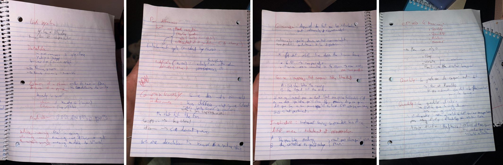
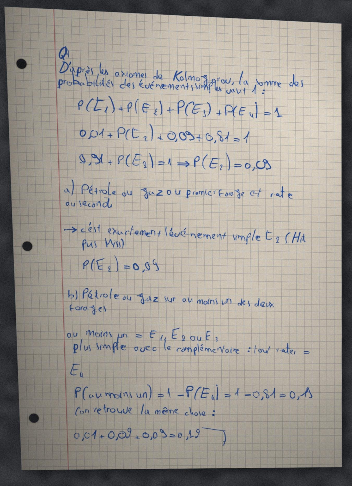
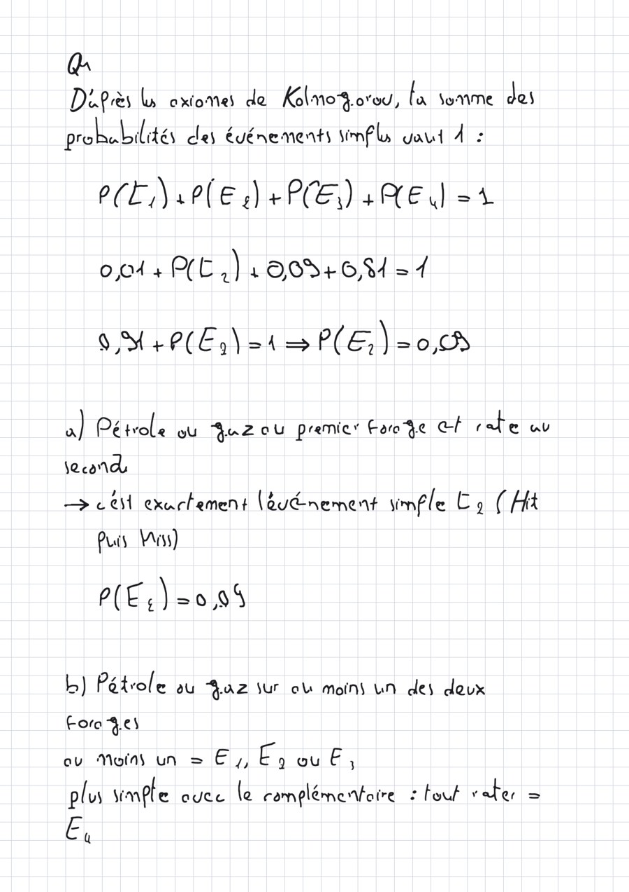
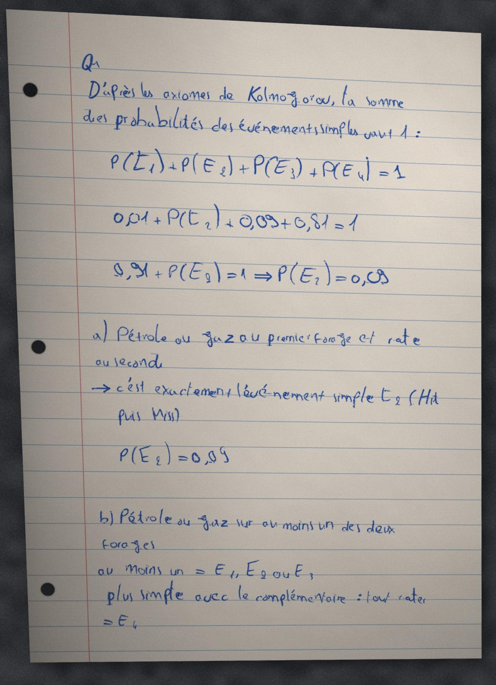

# text-to-handwritten-notes-skill

**Give an AI some text, a PDF or a photo. Get back a page that looks written by hand,** like a phone photo of a real notebook or a clean iPad page. It can use a default handwriting or **yours**, learned from photos of notes you already wrote.

It works as an [Agent Skill](https://agentskills.io) in Claude, ChatGPT, Codex and any agent that can run Python. It also works as a plain command-line tool. Free and open source.

⭐ **If it helped you, star the repo.** It helps other students find it.

## Example

**1. Photos of your handwriting** (optional). Any pages you already wrote work, so there is nothing to fill in:



**2. The content to write.** Paste it, or give a PDF or a photo; the AI reads it:

> Q4. D'après les axiomes de Kolmogorov, $P(E_1)+P(E_2)+P(E_3)+P(E_4)=1$, so $0{,}01 + P(E_2) + 0{,}09 + 0{,}81 = 1$ … (a) probability of a hit on the first well and a miss on the second … (b) probability of a hit on at least one well …

**3. The result** (PDFs: [notebook](examples/q4-solution-notebook.pdf), [iPad](examples/q4-solution-ipad.pdf), [lined](examples/q4-solution-lines.pdf)):

| Notebook photo (default) | iPad | Lined paper |
|---|---|---|
|  |  |  |

## How to use it

Ask in plain words:

> Write this solution by hand on squared paper.
> Make handwritten notes from this PDF, iPad style.
> Here are 5 photos of my notes: write my homework in my handwriting.

1. **Your handwriting:** send **as many photos of your writing as you can** (notes, homework, any pages). More pages mean more samples of each letter and a more natural result; 3 to 6 pages is good. If you send none, a default handwriting is used.
2. **The look:**
   - **notebook** (default): a phone photo of a real page, with uneven light, lines drifting down, and a sheet that is not quite straight.
   - **ipad**: a clean tablet page, with solid, even Apple Pencil ink and straight, tidy lines.
3. **The paper:** squared by default (even with your own handwriting or just an assignment), or lined, college ruled, French Seyès, dots, grid or blank if you ask.
4. **The input:** text, PDF, photo, anything. The AI reads it, OCR included, and writes the page.
5. **The output:** PDF or PNG.

Maths is drawn by hand: fractions, sums and integrals with bounds, limits, roots, powers and indices, intervals `[0, 1[`, ℝ ℕ, ∀ ∃ ∈ ⊂ ∩ ∪ ∅, and Greek letters. French accents are drawn on the writer's own letters.

## Install

- **Claude (claude.ai or desktop):** download the zip from [Releases](../../releases), then go to **Settings → Capabilities → Skills → Upload skill**.
- **Claude Code:**
  ```bash
  git clone https://github.com/yahyaraissouni/text-to-handwritten-notes-skill ~/.claude/skills/text-to-handwritten-notes
  ```
- **ChatGPT:** upload the same zip if your ChatGPT has Skills. If it doesn't, create a custom GPT: paste `SKILL.md` into *Instructions*, upload `scripts/handnotes.py`, `fonts/` and `hands/` as *Knowledge*, and turn on *Code Interpreter*.
- **Without an AI:**
  ```bash
  pip install pillow numpy
  python scripts/handnotes.py render examples/q4-solution.md -o page.pdf
  ```

## Command line

```bash
# render (default = notebook photo, squared paper, blue ink, default handwriting)
python scripts/handnotes.py render notes.md -o page.pdf
python scripts/handnotes.py render notes.md -o page.pdf --style ipad
python scripts/handnotes.py render notes.md -o page.png --paper lines --ink black

# learn a handwriting from photos of pages already written
python scripts/handnotes.py segment p1.jpg p2.jpg p3.jpg -o hand-work   # cuts the ink, makes numbered sheets
#   -> write hand-work/labels.json from the sheets (the AI does this step, see SKILL.md)
python scripts/handnotes.py build-hand hand-work hand-work/labels.json -o my-hand
python scripts/handnotes.py render notes.md -o page.pdf --hand my-hand
```

| option | values |
|---|---|
| `--style` | notebook (default), ipad |
| `--paper` | squared, lines, college, seyes, grid, dots, blank |
| `--hand` | default, a folder from `build-hand`, or none |
| `--font` | caveat, kalam, patrick, gochi, indie, playpen (instead of a handwriting) |
| `--ink` | blue, black, red, green, purple, pencil |
| `--page` | a4, letter, ipad, ipad-landscape |
| `--seed N` | the same page every time |

The page format (markup, maths) is described in [SKILL.md](SKILL.md).

## How it works

- **Learning:** the printed lines of the notebook are removed, every piece of ink is cut out, and the AI labels each piece by reading the page. Pieces holding whole words ("the", "dy") are kept as one block. Letters never written are built from the writer's own strokes (u from n, m from two n, w from two v). Accents are drawn on the plain letter.
- **Two engines:** the notebook engine keeps each letter as the pen left it, with pressure and faint parts, then ages the page into a phone photo. The iPad engine retraces every letter as one even, solid pencil stroke on a clean page.
- **Writing:** every letter is distorted a little differently, the baseline wanders and drifts down, and the ballpoint ink varies in pressure.
- **Photo:** curved paper, light from one side, a darker band near the binding, punch holes, a slight tilt and perspective, the background showing, sensor noise and JPEG.

## Roadmap

- [x] Notebook photo and iPad looks, 7 kinds of paper
- [x] Maths drawn by hand
- [x] A handwriting learned from any photos of notes, with no template
- [ ] Joined cursive between letters that were cut separately
- [ ] Red and blue ink mixed like real notes (titles in red)
- [ ] Hand-drawn tables and diagrams

## Versions

What changed in each version: [CHANGELOG.md](CHANGELOG.md). Download the latest from [Releases](../../releases).

## Licence

Code: MIT. Fonts (used only when asked, or for missing characters): Caveat, Kalam, Patrick Hand, Gochi Hand, Indie Flower and Playpen Sans, all under the SIL Open Font License (see `fonts/`).
