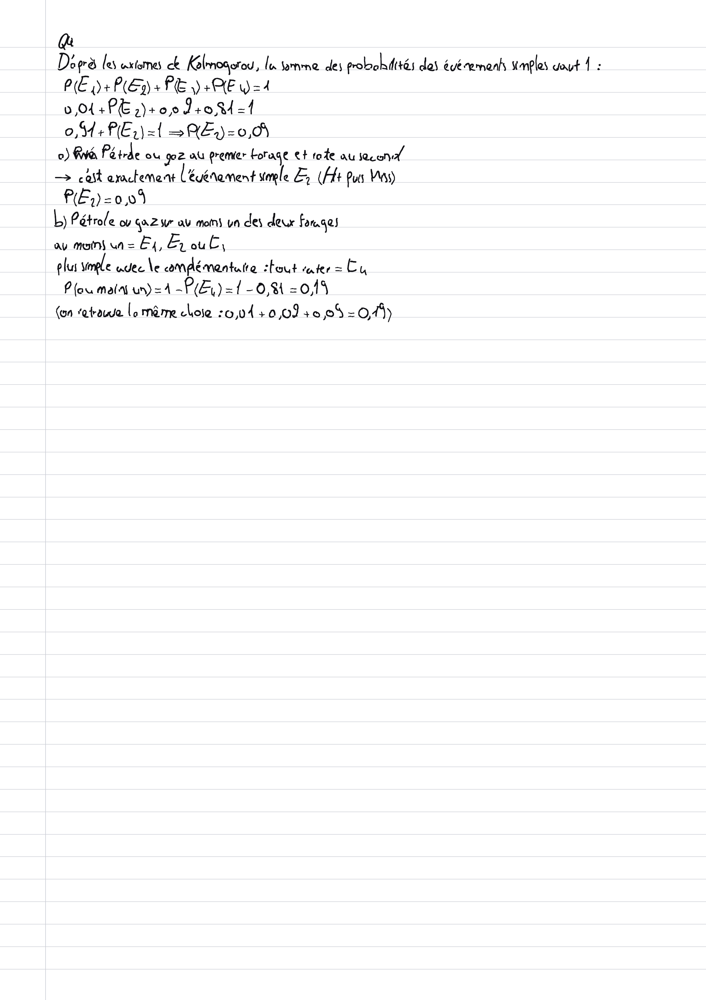
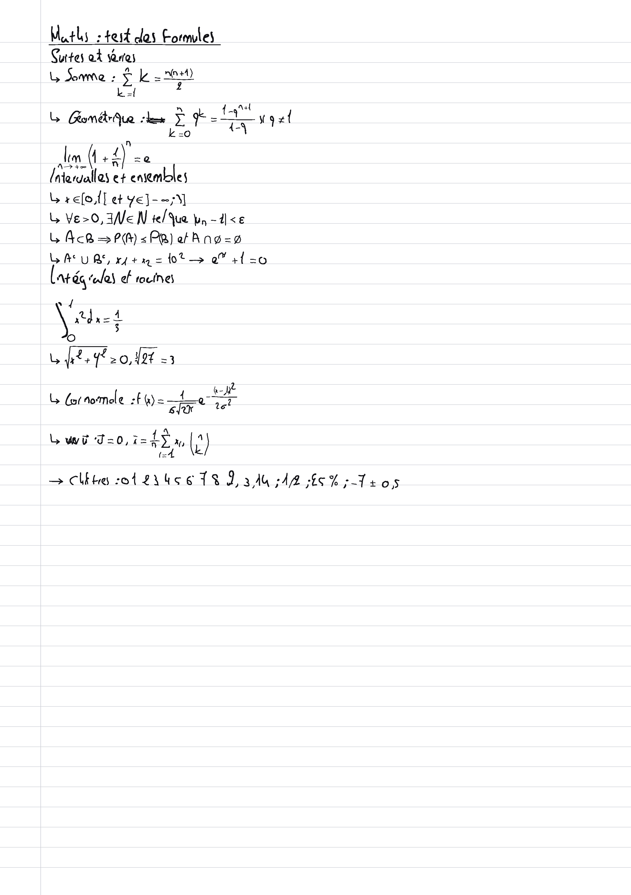
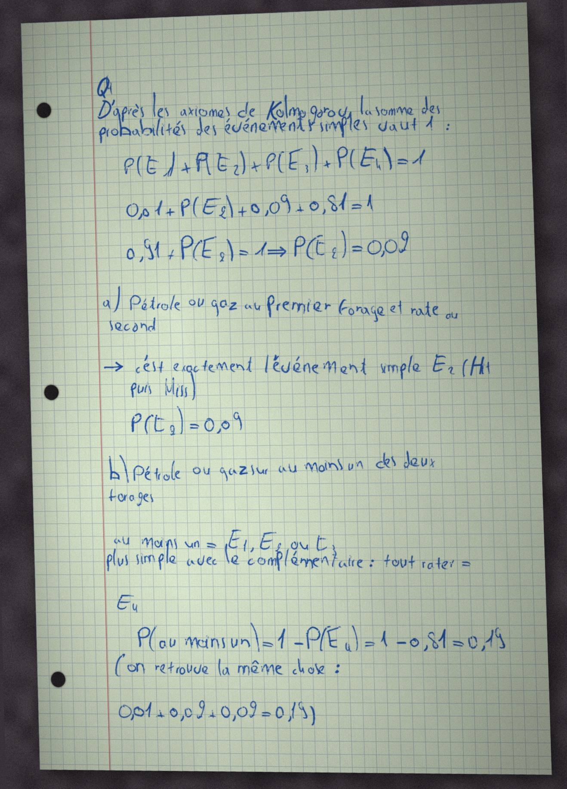

# text-to-handwritten-notes-skill

**Give an AI text, a PDF, or a photo—get back crisp 300 DPI handwritten notes** as a clean lined tablet page (`--style ipad --paper lines`, default) or a phone photo of a real notebook page (`--style notebook`). Uses a bundled default handwriting (`hands/default`) or **your own handwriting** (`hands/my-hand`), learned from photos of notes you already wrote.

> Enhanced fork of [`yahyaraissouni/text-to-handwritten-notes-skill`](https://github.com/yahyaraissouni/text-to-handwritten-notes-skill) (MIT License).

It works as an [Agent Skill](https://agentskills.io) in Antigravity, Codex, Claude Code, ChatGPT, and any agent that can run Python, or as a standalone CLI.

## What's New in This Enhanced Edition

- **300 DPI High-Contrast Digital Ink:** Renders A4 pages at full `2480×3508` (`300 DPI`) with solid black Apple Pencil ink and high-quality PDF export (`resolution=300, quality=95, subsampling=0`), keeping subscripts and nested fractions razor sharp.
- **Lined Tablet Paper & Anti-Overlap Layout:** Defaults to `--style ipad --paper lines` with subtle light-gray horizontal ruled lines, a left margin line, compact line density, and 2D bounding-box collision checks so tall fractions never collide with the line above.
- **Per-Character & Per-Symbol Organic Jitter (`--jitter` / `--no-jitter`):** Every letter (`a-z`, `A-Z`), digit (`0-9`), and pen-drawn math symbol (`\sum`, `\prod`, `\implies`, `\to`, `\approx`, `\leq`, `\geq`, `/`, `()`, `[]`, `\because`, `\therefore`, `\sqrt{}`) varies naturally in angle, arc depth, aspect ratio, and wobble on every occurrence. Pass `--no-jitter` to disable.
- **Optional Human Scratch-Outs (`--scratch` / `--no-scratch`):** Adds 1–2 subtle crossed-out false starts per page (`--scratch-rate N`) without obscuring real answers. Pass `--no-scratch` for spotless pages.
- **Crisp Math Operator Drawing:** Reworked 4-stroke `\sum` with centered limits above/below, plus Pillow 12 PDF export (`Image.init()`) and Windows UTF-8 BOM handling fixes.

## Example

| Lined iPad 300 DPI (default) | Math formulas (`--paper lines`) | Notebook photo (`--style notebook`) |
|---|---|---|
|  |  |  |

## Install

- **Antigravity / Codex / Claude Code:** clone into your global skills directory:
  ```bash
  git clone https://github.com/sl12711-design/text-to-handwritten-notes-skill- ~/.codex/skills/text-to-handwritten-notes
  ```
- **Standalone CLI:**
  ```bash
  pip install pillow numpy
  python scripts/handnotes.py render examples/maths.md -o page.pdf
  ```

## Command Line

```bash
# Default: 300 DPI A4 lined tablet page, black ink, jitter + subtle scratch-outs ON
python scripts/handnotes.py render notes.md -o page.pdf

# Clean lined mode without cross-outs or jitter
python scripts/handnotes.py render notes.md -o page.pdf --no-scratch --no-jitter

# Blank white iPad page or phone photo of a squared notebook
python scripts/handnotes.py render notes.md -o page.pdf --paper blank
python scripts/handnotes.py render notes.md -o page.pdf --style notebook

# Learn your own handwriting from photos of pages you already wrote (saved to hands/my-hand, gitignored)
python scripts/handnotes.py segment p1.jpg p2.jpg p3.jpg -o hand-work
# -> label pieces in hand-work/labels.json (see SKILL.md)
python scripts/handnotes.py build-hand hand-work hand-work/labels.json -o hands/my-hand
```

| option | values |
|---|---|
| `--style` | **ipad** (default: crisp 300 DPI Apple Pencil strokes on lined paper) · notebook (phone photo look with uneven lighting & ballpoint texture) |
| `--paper` | **lines** (default for ipad) · blank · **squared** (default for notebook) · college · seyes · grid · dots |
| `--hand` | **default** (`hands/my-hand` if present locally, else `hands/default`), a folder from `build-hand`/`learn`, or `none` |
| `--font` | `caveat`, `kalam`, `patrick`, `gochi`, `indie`, `playpen`, or path to `.ttf` |
| `--ink` | **black** (default for ipad) · **blue** (default for notebook) · red · green · purple · pencil |
| `--jitter` / `--no-jitter` | **--jitter** (default ON: per-character & per-symbol micro-variation) · `--no-jitter` (disable) |
| `--scratch` / `--no-scratch` | **--scratch** (default ON: 1–2 subtle cross-outs per page) · `--no-scratch` (disable) |
| `--scratch-rate N` | max cross-outs per page when `--scratch` is ON (default: `2`) |
| `--page` | **a4**, letter, ipad, ipad-landscape |
| `--seed N` | reproducible output for a given seed |

See [SKILL.md](SKILL.md) for markup syntax, supported LaTeX math, compact note rules, and handwriting extraction workflow.

## Licence & Attribution

- Original project by [yahyaraissouni](https://github.com/yahyaraissouni/text-to-handwritten-notes-skill) under the **MIT License** (see [LICENSE](LICENSE)).
- Bundled fallback Google Fonts (`fonts/`) are licensed under the **SIL Open Font License 1.1** (see `fonts/OFL-*.txt`).
- Personal custom hand directories (`hands/my-hand/`, `my-hand/`) are excluded via `.gitignore` so personal handwriting data stays private.
